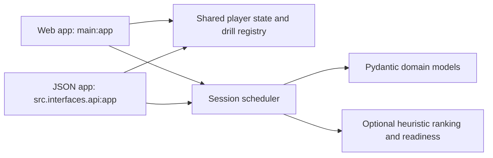

# Soccer Training Plan Generator

A Python/FastAPI prototype that helps coaches assemble structured soccer sessions from player profiles and a curated drill catalog. It separates scheduling rules, Pydantic domain models, HTML views, and a JSON API, with optional heuristic drill ranking and readiness scoring.

## Problem and key features

Coaches need useful sessions within a time budget while accounting for player position and skill level.

- Player profiles with position, skill level, and performance metrics.
- Position/level-based drill selection and greedy assembly within a duration budget.
- Coach overrides for intensity; the JSON API also supports drill additions/removals.
- Optional weighted recommendations and readiness-adjusted intensity, with base-selector fallback on ranking errors.
- In-memory state for local experimentation; optional JSONL event logging in the JSON API.

## Architecture and stack



The web and JSON apps are **separate FastAPI applications**. Starting `main:app` does not mount the JSON API. Both use the same modules, but separate server processes have separate in-memory player state.

| Path | Responsibility |
| --- | --- |
| [main.py](main.py), [web.py](src/interfaces/web.py) | HTML app entry, forms, templates, static assets |
| [api.py](src/interfaces/api.py) | JSON API application |
| [models.py](src/domain/models.py), [dto.py](src/interfaces/dto.py) | Domain validation and API contracts |
| [registry.py](src/catalog/registry.py) | Drill catalog and filtering |
| [scheduler.py](src/planning/scheduler.py) | Duration-limited session assembly |
| [src/ai](src/ai) | Feature scoring, ranking, readiness, explanations |
| [templates](templates), [static](static) | Jinja2 pages and CSS; homepage uses [index.html](index.html) |

Core stack: Python, FastAPI, Pydantic, Jinja2, uvicorn, pytest. SQLAlchemy/Alembic are declared dependencies, but these app paths use in-memory state.

## Getting started

Run from the repository root so relative template and static paths resolve:

```bash
git clone https://github.com/Advaith-1506/Soccer-Training-Plan-Generator.git
cd Soccer-Training-Plan-Generator
python3 -m venv .venv
source .venv/bin/activate  # macOS/Linux; Windows: .venv\Scripts\activate
pip install -r requirements.txt
# Required by FastAPI Form routes; missing from requirements.txt:
pip install python-multipart
python3 -m uvicorn main:app --reload --port 8000
```

Open [http://127.0.0.1:8000](http://127.0.0.1:8000). Static assets are mounted at `/static`; the plan template is [templates/plan.html](templates/plan.html).

**Fresh-install caveat:** dependencies have open-ended minimum versions. In the audit environment, planner tests and the homepage work, but `/players`, `/drills`, and `/ai/preview` return 500 with FastAPI 0.162.7 / Starlette 1.10.0. Existing positional `TemplateResponse` calls are incompatible with that resolved environment. Template-call updates or a verified dependency pin are required for those UI pages; application code is unchanged in this documentation update.

### Run the JSON API

```bash
python3 -m uvicorn src.interfaces.api:app --reload --port 8001
```

Open [interactive API docs](http://127.0.0.1:8001/docs). This process has its own player state.

## Routes

| App | Method | Path | Response/purpose |
| --- | --- | --- | --- |
| Web, port 8000 | GET | `/` | Homepage shell |
| Web | GET / POST | `/players` | HTML list / form submission |
| Web | GET | `/drills` | HTML catalog |
| Web | GET | `/plans/{player_id}` | HTML session plan |
| Web | POST | `/plans/{player_id}/override` | Form-based intensity override |
| JSON, port 8001 | GET / POST | `/players` | JSON list / create profile |
| JSON | GET | `/drills` | JSON catalog |
| JSON | POST | `/plans/{player_id}` | Generate plan |
| JSON | POST | `/plans/{player_id}/override` | Generate with overrides |
| JSON | POST | `/team/plans` | Plans for current players |
| JSON | GET | `/api/ai/health` | Diagnostic scheduler status |

The health endpoint hardcodes preview availability; it is not proof that the separate web preview is mounted.

## Optional recommendation preview

Copy [.env.example](.env.example) to a local `.env` and choose:

```dotenv
AI_PREVIEW_ENABLED=true
AI_SCHEDULER_ENABLED=false
```

`main:app` loads `.env` at import time; restart after changing the preview flag. Preview routes are `GET /ai/preview` and `GET /api/ai/preview/recommendations?player_id=...&top_n=5`, on the web app only.

`AI_SCHEDULER_ENABLED=true` enables ranking during session assembly. The JSON API does not call `load_dotenv()`: export the variable in its shell before starting it. These recommendations use local weighted heuristics, not an external LLM or a trained performance model. See [AI_README.md](AI_README.md).

## Tests and local walkthrough

```bash
pytest -q
```

The audit ran the existing planner suite: **3 tests passed**, covering basic generation and scheduler flag on/off behavior. This does not establish UI or API integration coverage.

Use the JSON app's `/docs` to create a profile, generate a plan, and apply an override. Inspect drill durations and intensity values in the responses. The HTML workflow is subject to the dependency caveat above. No hosted demo or verified screenshot is linked.

## Author and contributions

Maintained in [Advaith Madala's portfolio](https://github.com/Advaith-1506); [commit history](https://github.com/Advaith-1506/Soccer-Training-Plan-Generator/commits/master/) records attribution. Engineering review entry points are domain validation, drill filtering, session assembly, and the separate interface layers above.

## Limitations and next steps

- Player state resets on restart and is not shared between web/API server processes.
- The scheduler greedily selects from up to six drills; it is not an optimization solver or calendar scheduler.
- Override additions can change the time budget; the override path does not enforce every base-plan constraint.
- Unknown player IDs are indexed directly and can produce server errors.
- Pin a reproducible environment, repair template compatibility, and add route-level tests before relying on the UI.
- Use synthetic player information for public demos; logs may contain player IDs and plan details.
- No license file is present; choose one only after confirming rights.

See [CONTRIBUTING.md](CONTRIBUTING.md) for contribution guidance.
